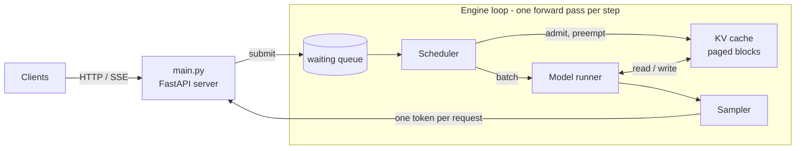

# mini-inference

An LLM inference engine built from scratch, in the style of vLLM and SGLang, to implement the core
serving techniques and **measure what each one is worth**. It serves a Mixture-of-Experts model
([OLMoE-1B-7B](https://huggingface.co/allenai/OLMoE-1B-7B-0125-Instruct)) and a dense model
([Qwen3-4B](https://huggingface.co/Qwen/Qwen3-4B-Instruct-2507)) on one RTX 5090.

**Python · CUDA C++ · Triton · PyTorch**

## Highlights

- **2.3× throughput at 64 users** (1,521 → 3,447 tok/s on OLMoE), through five profile-driven optimization rounds.
- **Three custom GPU kernels:**
  - fused MoE (Triton) plus MoE routing in CUDA C++, which together cut an MoE layer from 45–195 kernel launches to 5;
  - split-KV paged attention (Triton), reaching **92% of peak memory bandwidth**.
- **CUDA graphs:** 1.9× lower per-token latency at batch 1 (8.5 → 4.4 ms).
- **Correct by construction:** 42 tests check every feature combination produces **exactly the same tokens** as Hugging Face `generate()`.

## Optimization rounds

Each round followed the same loop: profile → find the bottleneck → fix → verify correctness → measure.

| Round | Bottleneck found | Fix | Result |
|---|---|---|---|
| 1 | MoE layers were 75% of GPU time, run as one small matmul per expert (~2,260 tiny kernels per step) | Fused MoE kernel in Triton | 64 users: 1,521 → 2,400 tok/s |
| 2a | Expert routing still took 32 of 37 launches per layer; batch 1 got *slower* | Routing as one CUDA C++ kernel | Batch 1: 9.7 → 6.8 ms/token (+42%) |
| 2b | Decode attention copied every request's KV cache each step | Split-KV paged attention in Triton | Long prompts: 41 → 19 ms/token (2.2×) |
| 2c | At small batches the CPU spent longer launching kernels than the GPU ran them | CUDA graphs for decode | Batch 1: 8.5 → 4.4 ms/token (1.9×); 64 users: 3,447 tok/s |
| 3 | Dense model: cuBLAS ran skinny decode matmuls at 17–50% of peak bandwidth | Fused q/k/v and gate/up; weight layouts autotuned | −2 ms per step, matching the microbenchmark's prediction |


## Features

Every feature is a startup switch (environment variable or `config.py`), so each one can be measured on its own.

| Area | Features |
|---|---|
| Scheduling | continuous batching (static and sequential for comparison), chunked prefill, admission control, preemption with recompute |
| KV cache | paged (PagedAttention-style) or contiguous, prefix caching, FP8/INT8 storage (~2× capacity) |
| Kernels | fused MoE (Triton), MoE routing (CUDA C++), paged decode attention (Triton), CUDA graphs, fused projections with layout autotuning |
| Quantization | INT8 and INT4 (group-wise) weight-only, FP8 weights and activations |
| Models | OLMoE and Qwen3-4B; a small registry also accepts Qwen3-MoE, Qwen2, Llama and Mistral |
| Tooling | HTTP server with streaming, load tests and sweeps, microbenchmarks, profiler with an automatic bottleneck report |

## Architecture



Each step, the scheduler picks which requests run. The model runner then processes all their new
tokens in **one flat batch with no padding**, so weights are read once for every user. Attention
reads each request's keys and values from the shared KV cache through its page table, and the
sampler streams one token back per request. Details: **[docs/DESIGN.md](docs/DESIGN.md)**.

## Quick start

```bash
conda create -n mini-inference python=3.12 -y && conda activate mini-inference
pip install torch --index-url https://download.pytorch.org/whl/cu130   # match your CUDA
pip install -r requirements.txt

# serve with every optimization on (MODEL=qwen3-4b for the dense model)
ENGINE=custom MOE_KERNEL=triton ATTN_BACKEND=triton CUDA_GRAPHS=1 python main.py

# benchmark without the server: 64 requests, 16 at a time
python bench/run_engine.py --engine custom -n 64 -c 16 --moe-kernel triton --attn-backend triton --cuda-graphs on

# tests (run on CPU, no downloads)
python tests/test_batching.py && python tests/test_models.py
```

## Repository

```
engine/          the engines: hf baseline and the custom engine
  core/          scheduler, KV cache, model runner, CUDA graphs, fused projections, sampler
  quantization/  INT8 / INT4 / FP8 weight quantization
kernels/         fused_moe/ (Triton + CUDA C++), paged_attention/ (Triton), each with a PyTorch reference
bench/           benchmarks, load tests, sweeps, quality checks, micro/ kernel benchmarks
profiling/       profiler wrapper and bottleneck analyzer
tests/           correctness tests (exact match against Hugging Face generate())
```


## Next steps

- CUDA graphs for steps that mix prompt and decode tokens ("piecewise" graphs). On the 36-layer dense model these steps take about a quarter of the time under steady load.
- Overlapping scheduling with GPU work, and a Triton skinny-GEMM kernel for the remaining gap to peak bandwidth.
- Quantized variants of the fused MoE kernel, so quantization saves time as well as memory.